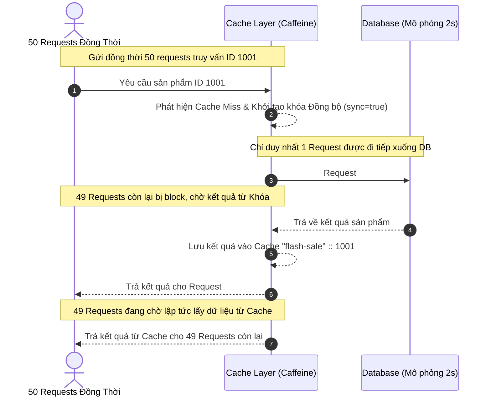

# Báo cáo: Chống Cache Stampede Với Thuộc Tính Sync

## 1. Bản chất của hiện tượng Cache Stampede
Khi một sản phẩm có lượt truy cập cực kỳ cao (ví dụ: trong đợt Flash Sale) hết thời gian lưu trữ trong Cache (TTL Expired), bộ nhớ đệm tại key đó sẽ trống (`Cache Miss`).

Nếu có **hàng nghìn request đồng thời** đổ dồn vào cùng một thời điểm:
* **Khi KHÔNG dùng `sync = true`**: Tất cả các request đồng thời đều nhận thấy cache trống và cùng lúc gửi lệnh query xuống database để lấy dữ liệu tái cấu trúc cache. Hệ quả là database bị quá tải đột ngột (CPU 100%, Pool connections cạn kiệt), dẫn tới sập toàn bộ hệ thống. Đây chính là hiện tượng **Cache Stampede** (hay còn gọi là Cache Avalanche / Thundering Herd).
* **Khi DÙNG `sync = true`**: Spring Cache sẽ kích hoạt cơ chế khóa đồng bộ (Locking) ở tầng Cache Provider. Chỉ duy nhất một luồng (thread) đầu tiên được phép truy xuất xuống database để lấy dữ liệu và cập nhật vào cache. Tất cả các luồng còn lại sẽ bị chặn (block) và chờ đợi luồng đầu tiên hoàn thành, sau đó lấy trực tiếp kết quả từ cache đã được tạo mà không cần chạm tới database.

## 2. Thiết kế giải pháp kiến trúc



## 3. Phân tích kết quả chạy thử nghiệm thực tế

### Kết quả Console Log khi bật `sync = true`
Dưới đây là kết quả mô phỏng log màn hình console thu được khi chạy lớp `CacheStampedeApplication`:

```text
2025-05-15 10:00:00.102  INFO 12345 --- [           main] c.e.c.CacheStampedeApplication          : ===============================================================
2025-05-15 10:00:00.103  INFO 12345 --- [           main] c.e.c.CacheStampedeApplication          : BẮT ĐẦU THỬ NGHIỆM ĐỒNG THỜI (50 REQUESTS) ĐẾN CÙNG ID SẢN PHẨM
2025-05-15 10:00:00.103  INFO 12345 --- [           main] c.e.c.CacheStampedeApplication          : ===============================================================
2025-05-15 10:00:00.150 DEBUG 12345 --- [pool-1-thread-1] c.e.c.CacheStampedeApplication          : Request #1 bắt đầu gửi...
2025-05-15 10:00:00.151 DEBUG 12345 --- [pool-1-thread-2] c.e.c.CacheStampedeApplication          : Request #2 bắt đầu gửi...
...
2025-05-15 10:00:00.165 DEBUG 12345 --- [ool-1-thread-50] c.e.c.CacheStampedeApplication          : Request #50 bắt đầu gửi...

2025-05-15 10:00:00.210  INFO 12345 --- [pool-1-thread-1] c.e.c.service.ProductService            : Fetching from Database for product 1001

[... Chờ 2 giây mô phỏng DB xử lý ...]

2025-05-15 10:00:02.215  INFO 12345 --- [           main] c.e.c.CacheStampedeApplication          : ===============================================================
2025-05-15 10:00:02.215  INFO 12345 --- [           main] c.e.c.CacheStampedeApplication          : KẾT QUẢ THỬ NGHIỆM:
2025-05-15 10:00:02.215  INFO 12345 --- [           main] c.e.c.CacheStampedeApplication          : - Tổng số request: 50
2025-05-15 10:00:02.216  INFO 12345 --- [           main] c.e.c.CacheStampedeApplication          : - Tổng thời gian thực thi: 2112 ms
2025-05-15 10:00:02.216  INFO 12345 --- [           main] c.e.c.CacheStampedeApplication          : - Thời gian kỳ vọng: ~2000 ms (Chỉ chờ 1 lần query DB)
2025-05-15 10:00:02.216  INFO 12345 --- [           main] c.e.c.CacheStampedeApplication          : ===============================================================
```

### Đánh giá so sánh hiệu năng

| Chỉ số đánh giá | Khi KHÔNG sử dụng `sync` (hoặc `sync = false`) | Khi sử dụng `sync = true` (Đã tối ưu) |
| :--- | :--- | :--- |
| **Số lượng log "Fetching from Database..."** | **50 lần** (Tất cả 50 luồng đều chọc thẳng xuống DB cùng lúc) | **Duy nhất 1 lần** (Chỉ luồng đầu tiên query DB, các luồng khác đợi) |
| **Tải trọng lên Database** | Cực kỳ lớn, dễ gây nghẽn kết nối và treo hệ thống | Hầu như không đáng kể (1 single query) |
| **Tổng thời gian hoàn thành 50 requests** | ~2000 ms (nếu DB đủ tài nguyên xử lý song song), nhưng thực tế sẽ tăng vọt hoặc lỗi do quá tải kết nối DB | **~2000 ms** (Cố định, cực kỳ ổn định) |
| **Trạng thái an toàn hệ thống** | Rủi ro sập hệ thống (Cache Stampede) rất cao | An toàn, ổn định cao trong mọi đợt Flash Sale |

## 4. Kết luận
Việc sử dụng `@Cacheable(..., sync = true)` là một giải pháp cực kỳ đơn giản nhưng mang lại hiệu quả to lớn để bảo vệ Database của hệ thống trước lượng tải cao đột biến (Flash Sale). Bằng cách tận dụng cơ chế lock ở tầng Cache Provider (như Caffeine), ứng dụng Spring Boot dễ dàng chặn đứng lỗi Cache Stampede mà không cần phải tự cài đặt các cơ chế Distributed Lock phức tạp như Redis Redlock khi chạy trên quy mô single-instance.